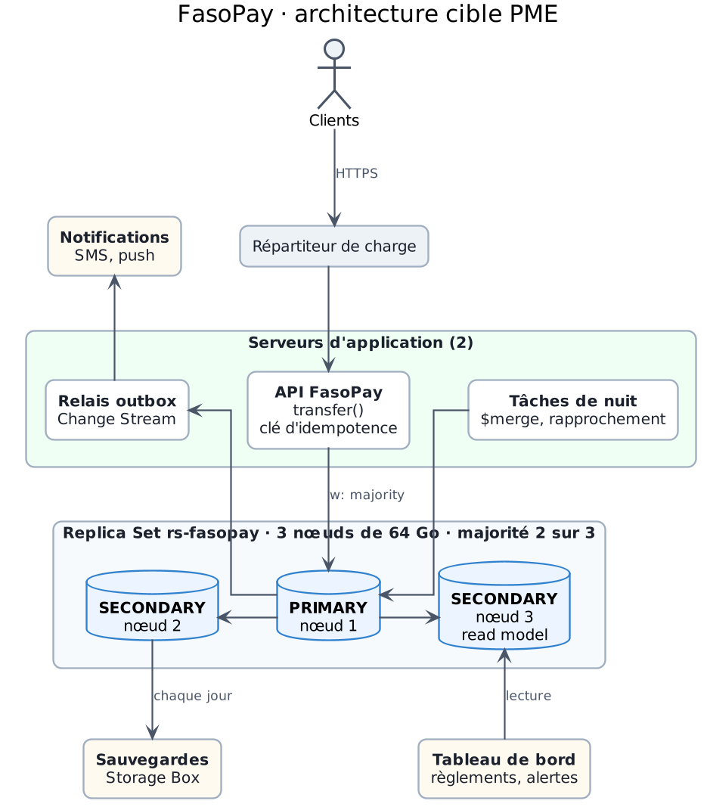

# 9. Partie 7 · Architecture proportionnée (+ ADR-003)

> Diagramme : `rapport/diagramme-architecture.png`. Chiffres : Partie 0 et annexe A ; preuves citées entre parenthèses.

Le CTO veut une architecture qui tienne la cible « sans acheter une usine à gaz ». Nous partons donc de nos chiffres, et non des outils à la mode : chaque composant retenu est justifié par une mesure, et chaque composant écarté a un seuil chiffré qui le ferait revenir. Nous terminons par la sécurité, le coût et la décision d'architecture (ADR-003).

## 9.1 Notre cible : PME (un Replica Set et un read model)

Nous déclarons la cible **PME**. Ce sont nos chiffres de la Partie 0 qui la fixent, pas une préférence :

| Critère | Notre chiffre | Ce qu'il exclut |
|---|---|---|
| Disponibilité exigée | 99,95 %, RPO de 0 pour l'argent | **Startup** : un serveur seul ne survit pas à sa propre panne, et les transactions multi-documents demandent un Replica Set (Partie 4). Nous avons mesuré 0 écriture `majority` perdue sur panne du primary (`preuves/05-failover.txt`), ce qu'un nœud seul ne peut pas offrir. |
| Working set | 25,9 Go, soit 40 % de 64 Go (54 % dans l'hypothèse prudente) | **Enterprise** : il tient dans le cache d'un seul nœud de 64 Go (31,5 Go de cache). |
| Volume | 224,4 Go de données par an, 307,9 Go avec les index | **Enterprise** : loin de la zone de 1 à 2 To par Replica Set ; 1 To non compressé n'est atteint qu'en 3,2 ans. |
| Débit au pic | 1 200 tx/s, soit 7 200 écritures de documents/s | Un seul primary peut suffire, **à condition** de le vérifier par un test de charge (330 virements/s mesurés sur notre ordinateur portable, 2 400 nécessaires : annexe A, section 2 ter). |
| Seuil de sharding | 490 M tx/an sur des nœuds de 64 Go | **Enterprise** : nous sommes à 400 M tx/an ; le sharding n'est pas nécessaire à 18 mois (Partie 6). |

Le tableau de bord et les règlements marchands ont besoin d'agrégats (chiffre d'affaires par marchand) qui ne doivent pas peser sur le primary : c'est le **read model**, la deuxième moitié de la cible PME.

## 9.2 Le diagramme

Ce diagramme ne contient que les composants de la cible : ni Kafka, ni Spark, ni Redis, ni shard. Il ne sert qu'à cette partie.

**Le chemin d'un virement :** le client passe par le répartiteur de charge, l'API appelle `transfer()` (Partie 4) avec sa clé d'idempotence ; la transaction écrit la transaction, les deux lignes de ledger, les deux soldes et l'événement `outbox` en une fois, en `w: "majority"` et `j: true` (ADR-002). Le relais lit les nouveaux événements `outbox` par Change Stream et envoie les notifications. Chaque nuit, une tâche recalcule le read model `ca_marchands` par `$merge` et rapproche le ledger des soldes (le contrôle de E1, Partie 2). Le tableau de bord lit ce read model sur un secondary.

## 9.3 Composants retenus, et le chiffre qui rend chacun nécessaire

| Composant | Le chiffre qui le rend nécessaire | Preuve |
|---|---|---|
| **Replica Set de 3 nœuds** (`rs-fasopay`) | RPO de 0 et 99,95 % de disponibilité (environ 21,6 min d'arrêt par mois) : avec 3 nœuds, la majorité vaut 2 et survit à la perte d'un nœud. Panne du primary : élection en 11,3 s, 627 écritures acquittées, **0 perdue**. Avec `w: 1`, une seule coupure fait perdre **97 écritures acquittées**. | `05-rs-status.txt`, `05-failover.txt`, `05-failover-w1.txt`, `05-rollback.txt` |
| **Nœuds de 64 Go de RAM** | Working set de 25,9 Go pour un cache de 31,5 Go (22 % de marge). Nous restons à 64 Go tant que les index restent sous 45 octets par entrée (27 mesurés). | `00-dimensionnement.txt`, annexe A, section 2 bis |
| **Disques de 2 × 1 To NVMe en RAID 1** | 198,5 Go par an sur disque ; avec 2 ans gardés en ligne (hypothèse 9 de l'annexe A), 397 Go sur 700 Go utilisables (70 % de 1 To), soit 57 %. Le RAID 1 garde le nœud en service si un disque lâche. | annexe A, section 2 |
| **`transfer()` avec clé d'idempotence** | Incident du 10/04 : **21 clés** rejouées et des paiements en double chez un marchand (E4). Nos tests : 3 rejeux, 1 seul débit ; 2 clients en concurrence, exactement 30 virements acceptés sur 50, solde jamais négatif. | `02-enquete.txt`, `04-transaction.txt`, `04-concurrence.txt` |
| **Client avec `heartbeatFrequencyMS=1000` et `retryWrites`** | Interruption d'écriture ramenée de **21,2 s à 10,6 s** pendant une élection, sans perte. | `05-failover-hb1.txt` |
| **Read model `ca_marchands`** (`$merge` quotidien, lu sur un secondary) | 224,4 Go par an, soit environ 615 Mo de données nouvelles par jour : un `$merge` par jour suffit. Un agrégat lu en direct sur le primary consommerait la capacité la plus fragile du dimensionnement (330 virements/s mesurés pour 2 400 nécessaires). E3 prend 23 ms sur le POC. | `03-explain.txt`, `04-debit.txt` |
| **Relais outbox par Change Stream** | Un seul consommateur des événements (les notifications) : un Change Stream avec resume token suffit (bonus B2). Sans outbox, une notification peut partir pour un virement annulé, ou se perdre. | annexe A, section 3 |
| **Rapprochement nocturne ledger / soldes** | **6 soldes incohérents**, pour un écart absolu de 138 000 FCFA, trouvés par E1. La finance doit voir le prochain écart le lendemain, pas par une plainte du support. | `02-enquete.txt` |
| **Alertes plafond vers `fraud_alerts`** | E2 trouve **5 wallets** qui découpent leurs transferts sous le plafond journalier. | `02-enquete.txt` |
| **Sauvegardes hors des nœuds** (Storage Box, restauration à un instant donné) | Le Replica Set protège contre la panne d'un nœud, pas contre une erreur humaine : une suppression faite sur le primary est répliquée sur les secondaries en quelques millisecondes. Il faut une copie quotidienne et l'oplog pour revenir à l'instant qui précède l'erreur. | Partie 5 |
| **2 serveurs d'application derrière un répartiteur** | Un seul serveur d'application rendrait inutile la disponibilité du Replica Set : sa panne arrêterait tous les virements. | ADR-002 |
| **Surveillance** | Trois seuils à suivre en continu : working set au-delà de 50 % de la RAM, index au-delà de 45 octets par entrée, retard d'un secondary au-delà de 30 à 60 s. | annexe A, sections 2 bis et 3 ; ADR-002 |

## 9.4 Composants écartés, avec le seuil qui les ferait revenir

| Composant | Pourquoi pas aujourd'hui (nos chiffres) | Nous le réintroduisons quand… |
|---|---|---|
| **Sharding** | 400 M tx/an ; working set à 40 % de la RAM ; 0,31 To par an non compressé. Si un jour il faut sharder, la clé est prête : `{ walletCle: "hashed" }` (Partie 6). | le volume dépasse **490 M tx/an** (working set à 50 % de la RAM sur 64 Go, soit la taille du cache) ; **ou** le test de charge montre que les écritures dépassent **50 % du débit du primary** même après une montée en gamme. |
| **Kafka** | Un seul consommateur des événements (le relais de notifications), servi par un Change Stream avec resume token. Kafka ajouterait un cluster de plus à exploiter (au moins 3 nœuds) pour un seul lecteur. | un **deuxième consommateur indépendant** (détection de fraude en temps réel, comptabilité) doit relire les événements au-delà de la fenêtre de l'oplog ; **ou** le relais prend plus de **60 s de retard** au pic de 1 200 tx/s. |
| **Spark / Data Lake** | Environ 615 Mo de données nouvelles par jour ; le `$merge` quotidien suffit et E3 prend 23 ms. | plus de **1 To à transformer par cycle** de calcul, **ou** des sources hors MongoDB à croiser (relevés des opérateurs télécom, des banques partenaires). |
| **Redis pour le solde** | Les 3 M soldes pèsent 0,43 Go et tiennent dans le cache ; une lecture par index unique, comme celle d'un solde par `_id`, prend 0 ms en médiane (Q3). Un cache ajouterait un risque : un solde affiché différent du solde réel, ce qui est justement la plainte du support. | une lecture de solde au-delà de **20 ms au p99** sous charge, **ou** plus de **20 000 lectures de solde par seconde** soutenues. |
| **Architecture Lambda** | Pas de besoin cumulé de temps réel et de recalcul historique lourd : le Change Stream couvre le temps réel, le `$merge` le recalcul. | les deux besoins à la fois, sans qu'un seul moteur puisse les servir. |
| **Nœuds de 128 Go** (montée en gamme) | 64 Go suffisent avec nos 27 octets d'index par entrée. | les index dépassent **45 octets par entrée**, **ou** le working set dépasse **50 % de la RAM** (annexe A, section 2 bis). |

## 9.5 Sécurité et conformité

**Authentification et rôles minimaux (prouvés).** Le serveur démarre avec l'authentification obligatoire (`security.authorization: enabled`). Nous avons créé trois rôles, un par usage, avec seulement les droits nécessaires (moindre privilège), et nous avons testé chaque utilisateur sur ce qu'il doit pouvoir faire et sur ce qu'il ne doit pas pouvoir faire : **18 vérifications sur 18 réussies** (`preuves/07-securite.txt`, annexe B, section 20).

| Rôle | Peut | Ne peut pas (testé) |
|---|---|---|
| `fasopay_application` (l'API) | insérer des transactions, ajouter des lignes de ledger, mettre à jour un solde, ajouter un événement `outbox` | **modifier ou supprimer une ligne de ledger**, supprimer la collection `ledger_entries`, supprimer un wallet, lire le read model |
| `fasopay_relais` | lire les événements `outbox` (Change Stream), les marquer envoyés, écrire une notification | modifier un solde, lire le ledger |
| `fasopay_tableau` | lire le read model `ca_marchands` | lire les transactions, écrire dans le read model |

Le ledger devient ainsi un journal en **ajout seul** pour l'application : même une API compromise ne peut pas réécrire l'historique de l'argent. Une connexion sans identifiants ne lit rien (`Unauthorized`, code 13). Les mots de passe ne sont pas dans le code : ils viennent de variables d'environnement (`.env`, hors du dépôt).

**Chiffrement.**
- *En transit :* TLS entre les clients et le répartiteur, entre l'API et MongoDB, et entre les nœuds du Replica Set (`net.tls.mode: requireTLS`), car les trois nœuds sont dans des centres de données différents.
- *Au repos :* le moteur de stockage chiffré de MongoDB n'existe que dans l'édition Enterprise (documentation MongoDB 8.0). Avec l'édition Community, nous chiffrons les disques au niveau du système (LUKS) et les sauvegardes avant leur envoi vers la Storage Box.

**Journal d'audit.** La documentation de MongoDB 8.0 ne décrit le journal d'audit que pour l'édition Enterprise et pour Atlas. Avec l'édition Community, la traçabilité vient de trois sources : le ledger lui-même (ajout seul, garanti par les rôles ci-dessus), le journal du serveur (connexions, erreurs) conservé hors des nœuds, et la séparation des utilisateurs (chaque écriture vient d'un utilisateur identifié par son rôle). Si l'autorité de contrôle exige un journal d'audit de chaque commande, il faudra passer à une édition qui le fournit : c'est un coût de licence que nous n'avons pas chiffré.

**Conservation des données de paiement.** Les lignes de ledger ne sont jamais modifiées ni supprimées par l'application. Les données de plus de 2 ans quittent les nœuds pour une archive chiffrée (hypothèse 9 de l'annexe A). Nous ne fixons pas de durée légale de conservation nous-mêmes : elle doit être validée avec le juriste de FasoPay et les autorités ci-dessous.

**Autorités à consulter.**
- La **Commission de l'Informatique et des Libertés (CIL)** du Burkina Faso, autorité de protection des données personnelles, créée par la loi n° 010-2004/AN du 20 avril 2004 ; le cadre a été actualisé par la loi n° 001-2021/AN du 30 mars 2021. Une question est à lui poser avant tout déploiement : nos serveurs sont en Allemagne et en Finlande (section 9.5), il s'agit donc d'un transfert de données personnelles hors du pays.
- La **BCEAO**, qui délivre l'agrément des établissements émetteurs de monnaie électronique dans l'UEMOA : ses exigences s'imposent à FasoPay en plus de celles de la CIL.

## 9.6 Coût indicatif mensuel

Prix publics hors taxes relevés en novembre 2026 (Hetzner), convertis au taux fixe de **1 € = 655,957 FCFA**.

| Poste | Quantité | Prix unitaire | Total par mois |
|---|---|---|---|
| Serveur dédié EX63 (64 Go DDR5 ECC, 2 × 1 To NVMe) : les 3 nœuds du Replica Set | 3 | 149,00 € | **447,00 €**, soit environ 293 213 FCFA |
| Storage Box 5 To (sauvegardes et archives) | 1 | 10,90 € | **10,90 €**, soit environ 7 150 FCFA |
| Serveur cloud CX33 (4 vCPU, 8 Go) avec son adresse IPv4 : API, relais, tâches, surveillance | 2 | 8,49 € + 0,50 € = 8,99 € | **17,98 €**, soit environ 11 794 FCFA |
| Répartiteur de charge LB11 avec son adresse IPv4 | 1 | 6,99 € + 0,50 € = 7,49 € | **7,49 €**, soit environ 4 913 FCFA |
| **Total mensuel** | | | **483,37 € HT, soit environ 317 070 FCFA** |

Une seule fois : frais d'installation des 3 EX63, 3 × 74 € = **222 €, soit environ 145 622 FCFA**. Sur un an : 5 800,44 € HT, soit environ 3 804 839 FCFA.

**Hypothèses du coût :**
1. Prix publics hors TVA, sans remise, relevés en novembre 2026 ; ils peuvent changer.
2. Nous avons écarté le serveur EX44 (59 €) : sa mémoire n'a pas de correction d'erreurs (ECC), un risque que nous ne prenons pas pour des soldes.
3. Les 3 nœuds sont placés dans des centres de données différents de l'hébergeur (Allemagne et Finlande), pour qu'un incident de site n'arrête pas la majorité.
4. Le coût ne comprend ni les personnes (exploitation, astreinte), ni l'envoi des SMS, ni le trafic au-delà du volume inclus, ni une licence MongoDB Enterprise (section 9.4).
5. Un hébergement au Burkina Faso ou dans l'UEMOA, si la CIL ou la BCEAO l'exigent, changerait ce coût : nous n'avons pas de prix vérifié à donner.
6. La latence entre Ouagadougou et l'Europe n'est pas mesurée ; elle doit rester compatible avec un p95 inférieur à 300 ms par virement (Partie 1).

## 9.7 ADR-003

Voir `adr/ADR-003.md` : *Cible PME : un Replica Set de 3 nœuds et un read model, sans Kafka, Spark, Redis ni sharding à 18 mois.*

**À retenir.** trois serveurs de 64 Go, un read model et un relais suffisent à la cible, pour environ 483 € HT par mois. Kafka, Spark, Redis et le sharding sont écartés aujourd'hui, chacun avec le chiffre qui le ferait revenir.

## Sources
- MongoDB, *Encryption at Rest* (édition Enterprise seulement) : https://www.mongodb.com/docs/manual/core/security-encryption-at-rest/
- MongoDB 8.0, *Auditing* : https://www.mongodb.com/docs/v8.0/core/auditing/
- Hetzner, serveur EX63 : https://www.hetzner.com/dedicated-rootserver/ex63/
- Hetzner, Storage Box : https://docs.hetzner.com/storage/storage-box/
- Prix Hetzner Cloud (CX33, LB11, IPv4), relevé du 24 octobre 2026 : https://cloudtally.eu/hetzner-cloud-prices
- CIL, loi n° 010-2004/AN : https://burkina24.com/?p=165202
- Loi n° 001-2021/AN et CIL : https://dataprotection.africa/burkina-faso/
- BCEAO, émission de monnaie électronique : https://www.bceao.int/fr/documents/qui-peut-emettre-de-la-monnaie-electronique-dans-luemoa-ou-lun-de-ses-etats-membres
